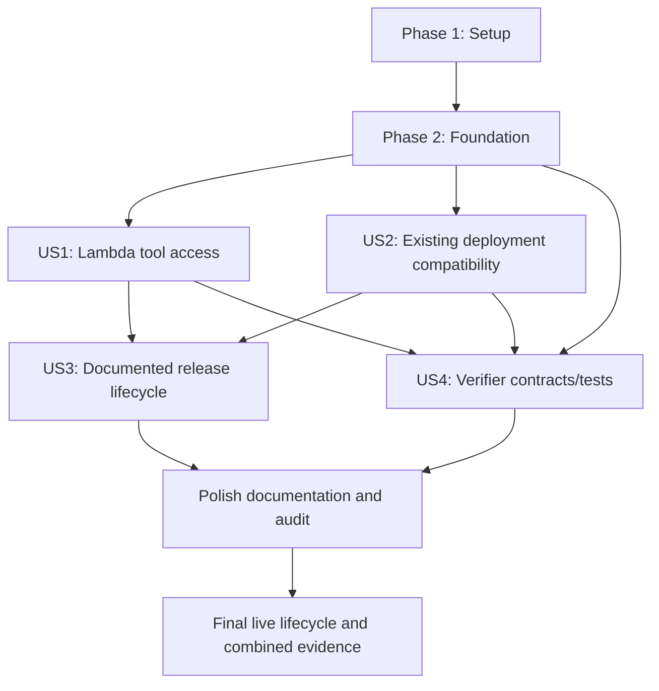

# Tasks: Add AWS Lambda Deployment

**Scope split — 2026-11-03**: This task list is service-only. Original T001–T044 retain their exact completion states. Pending access/gateway work moved to [spec 002](../../../mcp-auth-subscriptions/specs/002-authentication-api-access/tasks.md); separate billing Lambda/DynamoDB and entitlement ownership are specified in [spec 003](../../../mcp-auth-subscriptions/specs/003-billing-subscriptions/spec.md). See [the migration map](../scope-migration.md). ECR/publishing IAM and service-interface work remain here; no task adds identity/billing logic to MCP.

**Input**: Design documents in `specs/001-add-lambda-deployment/`: [spec.md](spec.md), [plan.md](plan.md), [research.md](research.md), [data-model.md](data-model.md), [contracts](contracts/deployment.md), and [quickstart.md](quickstart.md).
**Created**: 2026-11-01
**Working branch**: `main`; the active feature directory is `001-add-lambda-deployment`. Task generation does not create/check out a branch.
**Prerequisites**: Design artifacts above. The constitution remains an unfilled template; sample principles are not adopted requirements.
**Tests**: Included because FR-011/FR-012 and SC-001–SC-007 explicitly require verification, compatibility checks, and relevant existing tests. Write the named tests before their corresponding implementation; schema-only contracts can pass immediately, while missing feature behavior must fail meaningfully. This does not prescribe unrelated business-logic tests.
**Organization**: Setup → shared foundation → one phase per prioritized user story → cross-cutting completion. All tasks are initially unchecked.

## Format and Path Conventions

Each task uses `- [ ] T### [P?] [US#?] Description` with exact repository-relative paths (or explicitly external temporary evidence paths). `[P]` means an identified independent-file opportunity after its listed dependencies are complete, not permission to race edits in shared files. Dependency references are task IDs; **Covers** references the spec.

**Baseline and CI policy**: T001 freezes baseline_ref before implementation changes; T003 captures expectations from that revision. Verifier AWS imports stay lazy. T032 supplies the optional-group Python 3.11 deployment-test job; the original Python 3.10–3.13 default unit matrix remains independent. Cold-start acceptance requires request correlation to completed MCP interactions, not just a count of startup logs.

**Scope carried forward**: Reuse existing 39 tools; isolated ARM64 image/Lambda Web Adapter; immutable same-region ECR; spec-002-provided HTTP API v2/default stage and subscription-enforcing Cognito/custom authorizer; request-and-response-only MCP; all nine settings as native Lambda environment variables. No service authentication, startup token-retrieval hook, separate configuration store, provider-storage runtime permission, or new production AWS SDK dependency.

**Review ownership**: The existing custom requirements checklist has 63 unchecked reviewer items. Generating tasks does not approve them or change markers. Preserve its reviewer-owned state; the implementation workflow must apply its checklist gate separately. No checklist review is inferred from this task list.

**Evidence and live work**: Generated files are implementation work; AWS provisioning/live walkthroughs require supplied account/gateway/client prerequisites. Verifier live mode is read-only. Missing prerequisites must remain explicit `not_run`/outstanding acceptance, never fabricated passes or checked-off unperformed live tasks. Credential-bearing input files stay outside the checkout and evidence directory. Example evidence paths below are outside source; actual runs must bind artifacts to one run/release/target.

## Phase 1: Setup (Shared Tooling and Build Context)

**Goal**: Prepare optional validation tooling and a Lambda-specific build boundary.

**Independent test / checkpoint**: No story code is implemented yet; original runtime dependencies and Docker build context remain intact.

- [X] T001 Add and lock the optional deployment tooling group (boto3, JSON Schema validation, CloudFormation linting) for Python 3.11; keep production dependencies, the existing console entrypoint, and advertised Python support unchanged. Do not add a Lambda runtime SDK group or configuration-retrieval hook. Before changing tooling, record baseline_ref as the full pre-feature commit SHA in the baseline manifest (default to HEAD at implementation entry, not a later feature commit); require an explicit reviewed replacement if the baseline source is unavailable/dirty. Keep the existing Python 3.10–3.13 default unit matrix independent of optional AWS/lint dependencies; the dedicated Python 3.11 deployment-test job is delivered in T032. Files: `pyproject.toml`, `uv.lock`, `tests/integration/support/baseline.json`. Covers FR-006, FR-012.
- [X] T002 [P] Create the Lambda Dockerfile-specific build-context allowlist for packaging metadata, source, coinlists, README, and the Lambda Dockerfile; exclude all environment files, local credentials/agent configuration, tests, and private parameter/evidence files without changing the original Docker build context. Files: `Dockerfile.lambda.dockerignore`. Covers FR-005, FR-006, FR-007.

---

## Phase 2: Foundational (Blocking Shared Prerequisites)

**Goal**: Provide deterministic process fixtures, report contracts/core, and the reusable ECR bootstrap stack.

**Independent test / checkpoint**: Foundation checks pass; every story can use shared fixtures/report conventions. No feature deployment is claimed.

All story implementation depends on the shared foundation; contract test writing may use only the named completed prerequisites. Shared-file edits are serialized.

- [X] T003 [P] Create separate-process baseline/Lambda MCP launch helpers and controlled provider success/failure fixtures that retain real tool handlers and serialization; support paginated discovery and stdio/HTTP interactions without mutating singleton SDK state across processes or adding production fake-provider switches. Enrich the frozen baseline manifest from T001 with complete paginated tool descriptors, documented launch/health behavior, original publishing triggers/destination/architectures/tag rules, and capture/dependency identity. Derive all expectations from an isolated checkout/archive of baseline_ref; never regenerate them from candidate server/workflow code. Provide candidate-versus-frozen-baseline comparisons and reject missing/mismatched provenance. Files: `tests/integration/support/provider_fixture.py`, `tests/integration/support/baseline.json`. Depends on T001, T002. Covers FR-003, FR-004, FR-011, FR-012.
- [X] T004 [P] Add contract tests against the existing Draft 2020-12 report/lifecycle schema: required/unique 16 stages, nullable local target.gateway and authorization_evidence, exact gateway route count/payload/stage, missing/invalid denials, statuses and full-success thresholds; reject fabricated complete reports and malformed lifecycle identities. Files: `tests/unit/test_verification_report.py`, `specs/001-add-lambda-deployment/contracts/verification-report.schema.json`. Depends on T001, T002. Covers FR-011, FR-013, SC-007.
- [X] T005 [P] Add structural CloudFormation tests for repository immutability/scanning/encryption/ownership, scoped Lambda pull policy, retained repository behavior, and outputs. Keep tests focused on the deployment contract, with no cloud mutation or credential requirement. Files: `tests/integration/test_deployment_contract.py`. Depends on T001, T002. Covers FR-007, FR-015.
- [X] T006 Implement the project-owned ECR bootstrap stack with immutable tags, scanning, encryption, repository/account/region-scoped Lambda pull actions, ownership tags, RepositoryUri/RepositoryName outputs, and retention instead of automatic image pruning. Data-model constraints: Region — “Explicit commercial AWS region; example `ca-central-1`; API, ECR, and function share account/region”; RepositoryName — “Explicit project-owned ECR repository; example `tradingview-mcp-lambda`”. Files: `infra/lambda/ecr.yaml`. Depends on T005. Covers FR-007, FR-009, FR-015.
- [X] T007 Create the shared verifier report/CLI foundation for local, live, and combine modes, schema loading, sanitized evidence references, run/release/target identity, all 16 required stages initialized to not_run, and no inferred success. Preserve schema_version 1 and existing stage names; statuses are “pass”, “fail”, or “not_run”; every stage includes reason, nonnegative duration_ms, and evidence; passing stages need evidence. Preserve required nullable fields, source/lock/digest formats, and lifecycle definitions from the schema. Keep boto3/AWS and infrastructure-lint imports lazy/optional: module import and pure report/combine/argument semantics must work under the original default development environment without the deployment group. Actual live AWS operations must report missing optional tooling explicitly; they must not be silently skipped as passing. Files: `scripts/verify_lambda.py`. Depends on T004. Covers FR-013, FR-014, SC-007.

---

## Phase 3: User Story 1 — Use TradingView Tools Through Lambda (Priority: P1; MVP)

**Goal**: Deliver the isolated Lambda image/runtime and protected supplied-gateway connection while preserving all existing tools.

**Independent test / checkpoint**: With a candidate image, initialization/paginated discovery/controlled tool parity succeeds; with supplied live prerequisites, an authorized client connects through the gateway and an unauthorized caller is denied before service invocation. Cold/concurrency/full-live evidence is completed through US4; local-only evidence cannot close the live acceptance criteria.

- [X] T008 [P] [US1] Write Lambda-only unit tests for import isolation, initialization/lifespan, strict Host/Origin rules, slash normalization/method handling, all nine native environment values/defaults/size/ranges, empty optional credentials, and redacted failures. Demonstrate no service/client-token validation, configuration-store call, or AWS credential requirement. Files: `tests/unit/test_lambda_server.py`. Depends on T003, T007, T006. Covers FR-002, FR-004, FR-005, FR-008, FR-010.
- [X] T009 [P] [US1] Write wire-level parity tests using the process fixtures: initialize/initialized notification, all pages of 39-tool/resource discovery, controlled representative success/error values, invalid input/name, cross-process replacement, and independent concurrent requests with no request mixing or persistent session dependency. Compare names, descriptions, schemas, annotations, optional output schemas, and serialization. Load expected descriptors/results from the immutable baseline manifest and launch baseline code from its pinned revision; add a negative case where both candidate transport registrations drift identically and the frozen baseline still detects the regression. Files: `tests/integration/test_lambda_transport.py`. Depends on T003, T007, T006. Covers FR-003, FR-004, FR-011, SC-002, SC-003.
- [X] T010 [P] [US1] Extend infrastructure contract tests for ARM64 digest-only deployment, NoEcho native provider inputs, complete environment merging, log-only role, retained versions/live alias, direct protected supplied-gateway attachment, exact invocation policy scope, and absence of supplied infrastructure ownership, Function URLs, provider-storage access, or public principals. Files: `tests/integration/test_deployment_contract.py`. Depends on T003, T007, T006. Covers FR-001, FR-005, FR-009, FR-015.
- [X] T011 [P] [US1] Write image-driven tests for the native ARM64 image without source mounts, non-root access, read-only root/writable /tmp, packaged coinlists, strict readiness status 200, finite JSON MCP interaction, environment literal/special-character preservation, and credential/file exclusion. Missing Docker/native image prerequisites must be explicit unavailable/not_run evidence, never a passed container check. Files: `tests/integration/test_lambda_container.py`. Depends on T003, T007, T006. Covers FR-001, FR-004, FR-008, FR-010, FR-011.
- [X] T012 [US1] Implement the isolated Lambda entrypoint that validates supplied configuration, imports server.mcp exactly once, configures stateless_http=True/json_response=True before application creation, preserves the SDK session-manager lifespan, and runs one Uvicorn worker at 0.0.0.0:8000 with proxy headers disabled. Module import alone must not alter original settings; startup reads native environment and makes no configuration-fetching network call. Files: `src/tradingview_mcp/lambda_server.py`. Depends on T008, T009. Covers FR-001, FR-002, FR-004, FR-006.
- [X] T013 [US1] Add Lambda-only exact loopback/readiness and configured execute-api authority validation, DNS-rebinding protection, Origin rejection, internal /mcp/ normalization without redirects, and 405/Allow: POST for unsupported MCP methods. Retain exact GET /health JSON without upstream calls; permit credential-free internal MCP and health, pass lifespan unchanged, and keep sensitive headers/values out of logs. Do not implement bearer/JWT/OAuth authentication. Files: `src/tradingview_mcp/lambda_server.py`. Depends on T012. Covers FR-002, FR-004, FR-005, FR-008, FR-010, FR-014.
- [X] T014 [US1] Implement the locked multi-stage Python 3.11-slim image using uv sync --locked --no-dev --no-editable, packaged source/coinlists, /tmp/no-bytecode configuration, non-root-readable files, Lambda Web Adapter at /opt/extensions/lambda-adapter, port 8000, /health readiness accepting only 200, and buffered mode. Resolve/pin upstream image digests from registries during implementation and record actual identities; never invent them. Build one linux/arm64 image with provenance/SBOM attachments disabled; retain source/lock labels and test-local-before-push identity. Data-model constraints: source_commit — “Full source commit identifier, recorded in image labels and build evidence”; source_dirty — “Whether build inputs contained uncommitted source changes; report explicitly”; dependency_lock_sha256 — “Lowercase 64-hex digest of the build's `uv.lock`”; image_config_digest — “OCI configuration digest binding the tested local image to the registry manifest”; image_uri — “Same-account/same-region ECR repository plus immutable `@sha256:` manifest digest”; architecture — “Exactly `arm64` / build platform `linux/arm64`”; release_tag — “Unique immutable publishing tag, never reused for different content”; adapter_version / builder_version — “Adapter 1.1.0 and uv 0.13.1; resolved upstream image identities recorded during build”. Files: `Dockerfile.lambda`. Depends on T013, T011, T002. Covers FR-001, FR-003, FR-007, FR-008, FR-010.
- [X] T015 [US1] Implement runtime stack identity, log group, scoped log-writing role, ARM64 image function, release metadata, sizing parameters, ownership tags, digest/account/region validation, and no VPC/configuration store/application AWS permission. Fail explicitly for incompatible deployment inputs instead of silently changing architecture/concurrency. Data-model constraints: Region — “Explicit commercial AWS region; example `ca-central-1`; API, ECR, and function share account/region”; Runtime stack name — “Letter-led alphanumeric/hyphen name, at most 48 characters; also names function/log group”; ImageUri — “Immutable release artifact ECR digest”; DeploymentRevision — “Unique 1–64 character alphanumeric/dot/underscore/hyphen value for each application code/environment publication”; SourceCommit / LockSha256 — “Match build evidence and image labels”; MemorySize — “1024 MiB; validate supported Lambda range”; TimeoutSeconds — “25; integer 1–25, within the 30-second gateway integration window”; EphemeralStorageMb — “512; supported Lambda range 512–10240”; ReservedConcurrency — “5; positive integer; verify quota capacity before deployment”; LogRetentionDays — “14; supported CloudWatch retention value”. Files: `infra/lambda/runtime.yaml`. Depends on T010, T006, T014. Covers FR-001, FR-005, FR-009, FR-010, FR-014, FR-015.
- [X] T016 [US1] Map all nine application keys directly through Environment.Variables alongside public-host/adapter/release keys; add optional masked String credential parameters with empty defaults, preserve literal/special-character values and current no-news/no-proxy fallback, and validate NUL-free strings, aggregate 4-KB sizing, port/session bounds, and literal booleans with redacted diagnostics. No retrieval hook, runtime SDK, provider read/decrypt permission, credential output, or baked environment file is allowed. Data-model constraints: MarketauxApiToken / ProxyUsernamePrefix / ProxyPassword — “Optional strings, default empty; NoEcho true on all three deployment parameters; mapped directly to native Lambda environment variables”; MarketauxDailyBudget — “90; nonnegative integer, serialized as a string”; ProxyEnabled — “`true`; literal `true` or `false` string”; ProxyHost / ProxyPort — “`p.webshare.io` / 80; nonempty hostname and integer port 1–65535”; ProxySessionMin / ProxySessionMax — “1 / 250; positive integers with minimum no greater than maximum”. Data-model constraints: MARKETAUX_API_TOKEN — “Empty; preserves current no-news-provider fallback”; MARKETAUX_DAILY_BUDGET — “`90`; per execution environment/process, not a shared daily quota”; PROXY_HOST — “`p.webshare.io`”; PROXY_PORT — “`80`”; PROXY_USERNAME_PREFIX — “Empty; proxy remains unavailable without both prefix and password”; PROXY_PASSWORD — “Empty”; PROXY_SESSION_MIN — “`1`”; PROXY_SESSION_MAX — “`250`”; PROXY_ENABLED — “`true`; existing behavior additionally requires configured prefix/password”. Files: `infra/lambda/runtime.yaml`, `src/tradingview_mcp/lambda_server.py`. Depends on T015, T008. Covers FR-005, FR-009, FR-010, FR-014.
- [X] T017 [US1] Create the revision-bound published version and stable live alias, retaining replaced versions and outputting candidate/active version and release identity separately. Code and environment changes must create a version even when the image digest is unchanged; the gateway must invoke the alias-qualified ARN. Initial alias selection uses the newly published version; retained-version rollback selection is completed in US3. Files: `infra/lambda/runtime.yaml`. Depends on T016. Covers FR-001, FR-004, FR-009.
- [X] T018 [US1] Attach a feature-owned AWS_PROXY integration to the supplied HTTP API with backend method POST, payload 2.0, timeout 30000 ms; create ANY /mcp, ANY /mcp/, and GET /health, all CUSTOM with the supplied AuthorizerId. Scope alias permissions to apigateway.amazonaws.com, SourceAccount, exact API/$default stage/method-path patterns; produce the documented endpoint/attachment outputs. Require enabled execute-api endpoint and supplied AutoDeploy $default; never create API/stage/Cognito/authorizer, a Function URL, public invocation grant, or alter unrelated routes. Data-model constraints: ApiId — “Supplied existing HTTP API v2 ID; lowercase alphanumeric; execute-api endpoint enabled”; AuthorizerId — “Supplied REQUEST custom authorizer in that API; Authorization-header identity input; Cognito-backed policy owned externally”. Files: `infra/lambda/runtime.yaml`. Depends on T017. Covers FR-002, FR-005, FR-009, FR-015, SC-004.
- [X] T019 [US1] Implement local artifact/startup/initialization/discovery/tool-execution evidence using the new image and deterministic fixtures, then run the US1 unit, transport, container, and infrastructure checks with supplied prerequisites. Populate the existing report skeleton honestly; local authorization stays not_run and an image build/healthy process cannot establish deployed success. Record unavailable image/native prerequisites rather than substituting emulated timing. Files: `scripts/verify_lambda.py`. Depends on T018, T009, T011, T007. Covers FR-001, FR-002, FR-003, FR-004, FR-011, FR-013.

---

## Phase 4: User Story 2 — Keep Existing Deployment Options Working (Priority: P1)

**Goal**: Keep documented Docker/local behavior and the original image publication contract working.

**Independent test / checkpoint**: Build/start the original image with existing arguments/ports, check health and controlled MCP interaction, start stdio without AWS configuration, run relevant existing unit tests, and preserve original registry/architectures/tag rules.

- [X] T020 [P] [US2] Add original Docker/stdio regression tests covering documented commands/arguments, ports, GET /health, initialize/discovery/tool interaction, and startup without AWS/Lambda environment. Capture baseline from original Dockerfile/Compose/server launch behavior; isolate child processes and use deterministic provider results. Use baseline_ref and its captured launch/catalog contract, not candidate-derived expected values; build any baseline image from the isolated pinned source revision. Files: `tests/integration/test_original_transports.py`. Depends on T003, T007, T006. Covers FR-006, FR-012, SC-006.
- [X] T021 [P] [US2] Add compatibility tests against the original image publishing workflow for destination, architecture matrix, triggers, and tag rules; compare its pre-feature contract and ensure additive Lambda changes cannot modify it. Keep existing registry publishing behavior unchanged. Compare candidate publishing behavior to the manifest captured from baseline_ref; a changed candidate workflow must not redefine its own expected contract. Files: `tests/integration/test_release_workflow_contract.py`, `.github/workflows/publish-image.yml`. Depends on T003, T007, T006. Covers FR-007, FR-012, SC-006.
- [X] T022 [US2] Integrate original Docker/stdio launch checks into verifier local mode, preserving the baseline commands and health behavior without AWS configuration and managing only run-owned temporary processes/containers; wire their separate compatibility stages with sanitized evidence and reasons. Files: `scripts/verify_lambda.py`. Depends on T020, T019. Covers FR-006, FR-012, SC-006.
- [X] T023 [US2] Run and record the relevant existing hermetic unit suite and original release-workflow compatibility assertions through local verification; preserve opt-in stress behavior, capture nonzero failures/not_run prerequisites, and fix Lambda-owned regressions without changing original tool definitions or release contracts. Files: `scripts/verify_lambda.py`, `tests/unit/test_tool_annotations.py`, `tests/unit/test_tool_offload.py`. Depends on T022, T021. Covers FR-003, FR-006, FR-007, FR-012, SC-006.

---

## Phase 5: User Story 3 — Deploy, Update, and Roll Back From Documentation (Priority: P2)

**Goal**: Provide opt-in image publication and a clean-checkout operator lifecycle with native environment configuration and scoped recovery/cleanup.

**Independent test / checkpoint**: A reviewer follows only published instructions to deploy a supplied-gateway test installation, identify releases, update image and configuration independently, rollback, and remove only owned resources; use T030's evidence procedure and T044's final cross-story walkthrough, or record outstanding live steps.

- [X] T024 [P] [US3] Add structural/rendered-template tests for retained-version rollback, forward clearing of RollbackVersion, same-image environment-only publication, all deployment outputs, scoped deletion, and preservation of supplied API/stage/authorizer/Cognito/unrelated routes. Exercise omitted-versus-empty sensitive update intent and NoEcho/output exclusions using synthetic values. Files: `tests/integration/test_deployment_contract.py`. Depends on T018, T023. Covers FR-009, FR-014, FR-015, SC-001.
- [X] T025 [P] [US3] Add publication contract tests for manual-only workflow dispatch, native ARM64 gates, exact-repository/environment OIDC trust requirements, repository-scoped ECR push permissions, no static keys/automatic deploy, immutable tags, single-image manifests, and binding tested local image config digest to the pushed manifest. Files: `tests/integration/test_lambda_publication.py`. Depends on T014, T021. Covers FR-007, FR-009, FR-015.
- [X] T026 [P] [US3] Complete CloudFormation-managed retained-version selection, outputs, deletion ownership, and update lifecycle so forward updates explicitly clear a prior rollback pin and each code/environment publication requires a fresh revision; rollback preserves DeploymentRevision and changes no external client authorization. Native environment snapshots roll back with the selected version; document expired provider-value recovery. Data-model constraints: RollbackVersion — “Empty for new publication; otherwise retained numeric version of this function”. Files: `infra/lambda/runtime.yaml`. Depends on T024, T017. Covers FR-009, FR-015, SC-001.
- [X] T027 [P] [US3] Add the manual ECR publication workflow using native ARM64, Python/unit/transport/container gates, build-once/test/push-same-image, validated immutable digest/config identity, and scoped OIDC settings AWS_ROLE_TO_ASSUME/AWS_REGION/ECR_REPOSITORY. Preserve GHCR workflow, disable attestation-index publication for Lambda, upload only sanitized evidence, and never deploy the function automatically. Files: `.github/workflows/publish-lambda-image.yml`. Depends on T025, T019, T023. Covers FR-007, FR-009, SC-006.
- [X] T028 [US3] Write the deploy/update/rollback/cleanup operator guide from a clean checkout: ECR bootstrap, locked ARM image, supplied HTTP API profile, protected routes/endpoints, permission purposes/OIDC setup, account/region/digest/quota preflight, route-conflict rejection, sizing, finite transport/time/size limits, readiness/MCP diagnostics, and scoped cleanup propagation. Include manual MCP connection/smoke steps so basic use does not depend on the final report-combine phase. Data-model constraints: api_id, stage_name — “Existing HTTP API and `$default` auto-deploy stage; read-only prerequisites”; authorizer_id — “Existing custom authorizer plus externally managed invocation permission and Cognito policy”; credential instructions — “Owner supplies acquisition, refresh, expiry/revocation, accepted header/token policy; no user/account entity is added here”; access-log evidence location — “Owner supplies sanitized gateway correlation evidence sufficient to prove denial before service invocation”. Files: `docs/lambda-deployment.md`. Depends on T026, T027. Covers FR-002, FR-005, FR-007, FR-008, FR-009, FR-010, FR-014, FR-015.
- [X] T029 [US3] Document the full nine-key native environment matrix, parameter UI/private mode-0600 JSON outside checkout/build/evidence, CLI file-path input, NoEcho limitations, literal-character handling, temporary-file cleanup after failures as well as success, omitted-versus-empty updates, and preservation of adapter/unchanged credential inputs. Add configuration-only update/rollback without image rebuild, revoked-provider-value forward recovery, per-process budget scope, and external Cognito credential separation; use empty placeholders only. Files: `docs/lambda-deployment.md`. Depends on T028, T016. Covers FR-005, FR-009, FR-010, FR-014, FR-015, SC-001, SC-004.
- [X] T030 [US3] Define a schema-shaped lifecycle evidence capture procedure and sanitized example covering reviewer/time/targets, starting/distinct-updated/rollback image identities, environment-only update/rollback, supplied-resource preservation, and cleanup/documentation statuses. Clearly distinguish a procedure/example from an executed walkthrough; the final cross-story walkthrough in T044 collects live evidence before deleting its matching targets. Files: `docs/lambda-deployment.md`, `specs/001-add-lambda-deployment/contracts/verification-report.schema.json`. Depends on T029. Covers FR-009, FR-015, SC-001.

---

## Phase 6: User Story 4 — Confirm Health and Deployment Readiness (Priority: P2)

**Goal**: Deliver complete deterministic/local and read-only live verification with honest, provenance-bound reporting.

**Independent test / checkpoint**: Reports distinguish process/health, invalid authorization/connectivity, invalid inputs, provider errors, limits, and missing prerequisites. Required live evidence includes 20 complete interactions, five simultaneous clients, two fresh environments, and ten health probes within five seconds each; every required stage is pass/fail/not_run with no false full-success claim.

- [X] T031 [P] [US4] Add verifier semantic tests for local/live/combine provenance, exit codes, stage completeness, full-success gates, counts, release equality, dirty source, lifecycle target/release association, cold evidence deduplication, configuration-only evidence, redaction, missing prerequisites, and false-positive healthy-but-MCP-failed cases. Retain all schema constraints and reject incompatible merged evidence. Add negative fixtures rejecting health-only cold starts, cold requests from incomplete/failed interactions, wrong-release/time-window mappings, and unmatched gateway/platform request IDs. Add default-environment tests proving verifier imports and pure semantics do not require boto3 or infrastructure-lint dependencies. Files: `tests/unit/test_verify_lambda.py`. Depends on T007, T003. Covers FR-011, FR-013, FR-014, SC-007.
- [X] T032 [P] [US4] Add mocked AWS/HTTP integration tests enforcing read-only control-plane usage, exact API/stage/CUSTOM route/authorizer/integration/alias bindings, no-public-bypass inspection, gateway denial-before-backend correlation, separate provider failures, active environment revision privacy, and additional-target ownership. Reject a 500 authorizer error or missing correlation evidence as authorization pass. Test the completed-interaction to gateway-request to platform-request/environment join with independent mocked evidence; reject unrelated starts as cold_start success. Add the dedicated Python 3.11 push/PR deployment-test workflow with full baseline-ref availability, uv sync --dev --group deployment --locked, explicit hermetic report/infrastructure/verifier test selection, and template/schema linting. Missing deployment test dependencies or selected tests must fail the job rather than skip. Preserve the existing default Python matrix; no cloud credentials or live resource mutation are required. Files: `tests/integration/test_lambda_verifier.py`, `.github/workflows/test-lambda.yml`. Depends on T007, T003. Covers FR-005, FR-008, FR-011, FR-013, FR-014, SC-004.
- [X] T033 [US4] Complete verifier local mode for invalid tool name/input, controlled upstream error parity, provider-independent health during simulated provider failure, method/Host/Origin/slash handling, native environment/redaction, and time/size failures; ten consecutive warm health checks must each finish within five seconds and invoke zero providers. Keep existing compatibility/unit stages and leave authorization/cloud-only stages explicitly not_run. Files: `scripts/verify_lambda.py`. Depends on T031, T023, T019. Covers FR-008, FR-010, FR-011, FR-012, FR-013, SC-005.
- [X] T034 [US4] Implement read-only live target resolution from named stacks plus independent Lambda/ECR/API observations: bind active alias/version/resolved digest, local config versus registry manifest config digest, source/lock labels, native nonsecret settings/configuration revision, and supplied gateway metadata. Compare exact three route keys, CUSTOM authorizer, AWS_PROXY payload 2.0, $default AutoDeploy, endpoint/permission scope, absent Function URLs, and unrelated public integration paths. Never dump resolved environments or credentials. Data-model constraints: stack_id, account_id, region — “Scope/ownership for control-plane operations”; function_arn, version, alias_arn — “Exact function/version and stable `live` alias”; api_id, stage_name, authorizer_id — “Supplied access-control identifiers; stage is `$default`”; integration_id, route_ids — “Feature-owned AWS_PROXY payload-2.0 integration plus exactly three routes: `ANY /mcp`, `ANY /mcp/`, `GET /health`, all CUSTOM”; api_endpoint, mcp_endpoint, health_url — “Supplied API's execute-api HTTPS base URL and `/mcp`, `/health`; no credentials or Function URL”; resolved_image_uri — “Digest actually reported by Lambda for the alias's active version”; log_group_name — “Project-owned Lambda log group for diagnosis/cold evidence”. Files: `scripts/verify_lambda.py`. Depends on T032, T033, T018. Covers FR-005, FR-011, FR-013, FR-014, SC-004.
- [X] T035 [US4] Implement live missing/invalid credential denial checks for discovery/execution and all feature routes including external health; read client bearer only from TRADINGVIEW_MCP_TOKEN. Require 401/403, gateway request IDs, service_invoked false established through sanitized gateway/integration/Lambda correlation, configuration evidence, and public_bypass_absent true. Optional expired-credential evidence is separate. Missing evidence/prerequisites remains not_run, not an inferred pass; store the schema-required authorization_evidence object only for observed evidence. Files: `scripts/verify_lambda.py`. Depends on T034. Covers FR-005, FR-011, FR-013, FR-014, SC-004.
- [X] T036 [US4] Implement real-release live protocol checks with at least 20 complete initialize/discover/futures_watchlist interactions, a burst of at least five simultaneous clients, ten warm health probes, invalid tool input, and supported finite JSON/notification behavior. Use a ten-second connection limit and 35-second response deadline; distinguish gateway/Lambda limit failures and never count partial results as success. Record the optional live market-provider probe separately from deterministic tool/state checks. Emit completed-interactions.json as sanitized stage evidence, recording interaction_id, complete success of initialization/discovery/tool call, and authoritative request correlations for those MCP requests (gateway_request_id, platform_request_id, function ARN/version, log stream, observed time). Do not include credentials, request/result bodies, health requests, or failed/incomplete sequences as completed-interaction evidence. Missing correlation stays incomplete rather than being invented. Files: `scripts/verify_lambda.py`. Depends on T035. Covers FR-002, FR-004, FR-008, FR-010, FR-011, SC-003, SC-005.
- [X] T037 [US4] Implement scoped CloudWatch/Lambda read evidence for at least two distinct fresh execution environments bound to tested function/version/image and request/init/REPORT observations. Validate additional same-release targets have matching intended native settings and separate supplied compatible APIs; deduplicate environment identities. Do not infer cold starts from sessions/idle time or create/update resources to force them; insufficient evidence remains not_run. Count a fresh environment only when its startup platform_request_id joins, through gateway/integration evidence, to an MCP request belonging to a successfully completed interaction from T036 for the same run/release/target. The cold request can be initialization, discovery, or tool execution; a tool call need not itself trigger initialization. Require at least two distinct qualifying environment identities; health/readiness-only or otherwise unrelated starts do not count. Files: `scripts/verify_lambda.py`. Depends on T036. Covers FR-004, FR-011, FR-013, SC-003.
- [X] T038 [US4] Implement combine provenance and semantic validation beyond schema: expected/resolved image equality, tested local image config matching registry config, source/lock identity, counts not exceeding attempts and zero failed primary interactions, distinct cold identities, every lifecycle step passing, and lifecycle stacks a subset of reported targets. Require starting_image_uri == rollback_image_uri == final expected/resolved URI and a distinct updated_image_uri; keep environment-only lifecycle evidence in addition to that image-release evidence. Only combine can claim full success when all mandatory stages and thresholds pass. Revalidate every counted cold record against completed-interactions.json and its correlation evidence, and derive evidenced_fresh_starts only from distinct qualified joins. Reject or mark cold_start not_run when links are missing; unrelated starts cannot satisfy SC-003 or full success even if raw cold_start_evidence contains two records. Bind the sidecar through the existing stage evidence ref/SHA-256 contract; do not change schema_version or create a new mandatory stage. Files: `scripts/verify_lambda.py`. Depends on T037, T031. Covers FR-011, FR-012, FR-013, SC-001, SC-003, SC-007.
- [X] T039 [US4] Finalize argument validation, sanitized reports/reasons/evidence, UTC run timestamps, all schema-required fields, and exit codes: 0 full success, 1 failed attempted acceptance, 2 incomplete not_run without failed checks, 3 invalid configuration/evidence/provenance. Local-only normally exits 2; missing external client credentials/evidence cannot establish authorization. Keep live mode AWS-read-only and preserve all 16 stage names and the optional live_market_probe. Files: `scripts/verify_lambda.py`. Depends on T038. Covers FR-013, FR-014, SC-007.
- [ ] T040 [US4] Run the verifier/test acceptance matrix: working local image, healthy process with failing MCP/auth, controlled upstream failure, invalid input, time/size cases, and real deployed-target checks when prerequisites exist. Record local/live evidence for the exact tested release and explicit outstanding/not_run live stages when unavailable. Do not mark an unperformed required live acceptance check complete or claim deployment success from mocks/local evidence. Files: `scripts/verify_lambda.py`, `/tmp/tradingview-lambda-evidence/local.json`, `/tmp/tradingview-lambda-evidence/live.json`. Depends on T039, T029. Covers FR-011, FR-012, FR-013, FR-014, SC-003, SC-004, SC-005, SC-007.

---

## Phase 7: Polish & Cross-Cutting Completion

**Goal**: Publish discoverable guidance, reconcile runnable docs, and assemble final evidence after privacy/compatibility review.

**Independent test / checkpoint**: All desired story checks and required live gates are evidenced or explicitly outstanding; no unrelated feature or reviewer approval is invented.

- [X] T041 [P] Add the Lambda deployment documentation entry/link while preserving original Docker/local instructions, launch commands, and existing image publishing usage; clearly identify supplied authorization prerequisites and native environment scope. Files: `README.md`. Depends on T040, T030. Covers FR-006, FR-007, FR-009.
- [X] T042 [P] Reconcile the planning quickstart with delivered file paths/commands, private JSON input schema, verifier stages/exit codes, supported gateway profile/limits, and actual availability; keep source guidance explicit that successful health/generic MCP does not validate optional provider credentials. Preserve reviewer-owned checkbox markers. Files: `specs/001-add-lambda-deployment/quickstart.md`. Depends on T040, T030. Covers FR-009, FR-010, FR-013, FR-014.
- [X] T043 Audit final template/image/workflow/docs/report artifacts for credential leakage, full-environment dumps, storage-fetch hooks/runtime SDK grants, public invocation paths, unsupported streaming, supplied-resource ownership/deletion, and original Docker/GHCR drift. Check deployment lint, schema, and documentation links; reuse passing test evidence rather than repeating unchanged tests, and rerun only checks affected by fixes. Files: `infra/lambda/runtime.yaml`, `Dockerfile.lambda`, `.github/workflows/publish-lambda-image.yml`, `docs/lambda-deployment.md`. Depends on T041, T042. Covers FR-003, FR-005, FR-006, FR-007, FR-010, FR-014, FR-015.
- [ ] T044 Execute the clean-checkout deploy/distinct-image update/rollback and same-image environment-update walkthrough using the delivered guide and supplied prerequisites; collect or reuse release/target-matched local/live evidence while those exact runtime targets still exist, then remove only owned test resources and record lifecycle/supplied-infrastructure preservation evidence. Run the final combine operation only after those matching live and cleanup records exist. Full success requires all mandatory stages and quantitative floors; absent prerequisites or unperformed live steps remain not_run/outstanding and must not be checked off as completed acceptance. Record completion/limitations without changing reviewer-owned checklist markers. Files: `scripts/verify_lambda.py`, `docs/lambda-deployment.md`, `/tmp/tradingview-lambda-evidence/lifecycle.json`, `/tmp/tradingview-lambda-evidence/final.json`. Depends on T043, T040, T030. Covers FR-009, FR-011, FR-012, FR-013, FR-015, SC-001, SC-007.

---

## Dependencies & Execution Order

### Phase and Story Graph

US2's baseline tests can start independently after foundation, while its verifier integration follows US1's local runner to avoid same-file races. US3's publication contract tests can begin after the image/original release contract is ready; its final lifecycle walkthrough needs a supplied live target. US4's tests can start after foundation, but its final local/live engine integrates US1/US2. US3's manual endpoint instructions do not require the final combine implementation; final combined acceptance in T044 executes the US3 lifecycle procedure and gathers US4 live evidence on the same targets before cleanup. T030 is a procedure/example task, not a premature teardown or a claim of a completed live walkthrough. Runtime/verification implementation can proceed without a cloud account; unperformed live acceptance remains outstanding.

### Shared-File Ordering

- `infra/lambda/runtime.yaml`: T015 → T016 → T017 → T018 → T026. Do not parallelize these edits.
- `src/tradingview_mcp/lambda_server.py`: T012 → T013; T016 then completes native-setting constraints.
- `scripts/verify_lambda.py`: T007 → T019 → T022 → T023 → T033 → T034 → T035 → T036 → T037 → T038 → T039 → T040; final assembly is T044.
- `tests/integration/test_deployment_contract.py`: T005 → T010 → T024; tests precede the corresponding implementation increments.
- `docs/lambda-deployment.md`: T028 → T029 → T030; final audit/evidence notes follow the completed stories.

### Parallel Opportunities and Examples

These are scheduling examples, not requests to spawn agents. Each pair/group touches different files and waits for its own dependencies.

| Story / phase | Independent tasks | Ready when |
|---|---|---|
| Setup | T001 + T002 | Immediately; tooling and context allowlist are separate files |
| Foundation | T003 + T004 + T005 | Setup complete; process fixtures, schema tests, and ECR contract tests are separate files |
| US1 | T008 + T009 + T010 + T011 | Foundation complete; unit, wire, infrastructure, and container test files are separate |
| US2 | T020 + T021 | Foundation complete; original transport and original publication contract tests are separate |
| US3 | T024 + T025 | Their listed US1/US2 prerequisites are complete; lifecycle and publication tests are separate |
| US3 implementation | T026 + T027 | Their tests/prerequisites complete; runtime lifecycle and new publishing workflow are separate |
| US4 | T031 + T032 | Foundation complete; verifier semantics and mocked AWS/HTTP contract tests are separate |
| Polish | T041 + T042 | Story verification/evidence-procedure prerequisites complete; README and quickstart are separate |

### Constraint Traceability

Task descriptions quote data-model field constraints verbatim where those fields are implemented. Release artifact constraints belong to T014; runtime/sizing/identity to T015; all native environment/default/credential constraints to T016; API/authorizer inputs to T018; retained-version selection to T026; supplied access ownership to T028; deployment/endpoint evidence to T034. The existing report schema remains the exact structural authority for all nullable/required, enum, format, pattern, minimum, and unique-stage constraints in T004/T007/T031/T034–T039.

## Implementation Strategy

1. Complete Setup and Foundation, then make US1 pass its local/unit/wire/native-container contracts. This is the functional MVP: existing tool access through the isolated Lambda deployment with supplied gateway authorization. Preserve the P1 US2 compatibility baseline before publishing or demonstrating the candidate.
2. Deliver US2 compatibility evidence, US3 publication/operator lifecycle, and US4 reporting incrementally. Reuse the same tested image rather than rebuilding between local validation and ECR push; use immutable digests and explicit environment revisions.
3. Validate each story's independent checkpoint. Record missing cloud/native/account/evidence prerequisites without turning omissions into success, and resume the associated live acceptance work when inputs exist.
4. Run targeted checks for each change; reuse already passing evidence until a new change or failure justifies rerunning. Do not use live market-price equality as a deterministic compatibility check.
5. Finish with privacy/resource-ownership/compatibility audit and a schema-valid combined report. Full deployment success requires every required live stage and quantitative floor, plus the separate clean-checkout lifecycle walkthrough.

## Completion Notes

All tasks are initially unchecked implementation work. Tests listed above are required by this feature's verification requirements, not a declaration they have run. No AWS operations, image builds, implementation edits, or reviewer checklist approvals are performed by task generation. The placeholder constitution does not create additional approval requirements. Extension hook dispatch is handled by the invoking workflow.

**Generation validation**: 44 unchecked tasks; phase counts 2/5/12/4/7/10/4; story counts US1 12, US2 4, US3 7, US4 10; 18 parallel markers. IDs, phase/story labels, exact paths, earlier-ID dependency references, local document links, all FR/SC references, and verbatim data-model table constraint coverage were checked. The final walkthrough gathers live evidence before cleanup. No pre/post tasks extension hooks are configured. This validates task structure and traceability, not implementation or deployment success.

**Analysis remediation — 2026-11-02**: C1 adds completed-interaction/cold-start request correlation and rejection cases; U1 pins the pre-feature baseline and immutable expectations; U2 specifies lazy verifier imports and a separate optional-group deployment-test CI job. Existing task IDs, dependency references, and checkbox states are retained. Validation passed for 44 task IDs/labels/markers, their backward-only dependencies, all FR/SC assignments, 28 links, seven shell blocks (syntax only), and the preserved structural report schema. No implementation or live verification is claimed.

## Historical Service Implementation Status — 2026-11-02

42 of 44 tasks are implemented and checked. The user explicitly authorized proceeding past the checklist gate; custom reviewer markers remain unchanged (63 unchecked), and the built-in requirements checklist remains 16/16 checked. No requirements-quality approval is inferred.

Validation: 516 hermetic unit/integration tests passed with both native ARM64 images (no skipped tests), including frozen-baseline catalog/controlled error parity, concurrency/replacement, read-only image storage, limits, original Docker/stdio behavior, gateway snapshots, private configuration intent, and semantic evidence/combine cases. Both CloudFormation templates pass cfn-lint; documentation links, JSON examples, and shell/workflow blocks validate. Existing production metadata/dependencies and original locked versions are preserved. No AWS resource has been changed and no ECR image published. The local build explicitly records dirty source.

Local verifier evidence: `/private/tmp/tradingview-lambda-evidence/local.json` — all 10 locally eligible stages pass; six cloud/lifecycle stages remain not_run, exit 2, full_deployment_success false. `/private/tmp/tradingview-lambda-evidence/live.json` is explicitly an unperformed report with unknown target/release fields left null, not live evidence. Validation summary: `/private/tmp/tradingview-lambda-evidence/implementation-validation.json`; full test record: `/private/tmp/tradingview-lambda-evidence/final-local-pytest.xml`.

T040 remains unchecked for real supplied-target acceptance (authorization-before-backend, 20 interactions/five clients/two correlated fresh environments, and live release identity). T044 remains unchecked for the clean-checkout AWS deploy/distinct-image update/rollback, same-image configuration lifecycle, scoped cleanup and final combined acceptance. Supply the region, disposable stack name, existing compatible HTTP API/REQUEST authorizer, published release and external credential/correlation prerequisites before those steps. No final lifecycle/combine success has been fabricated. No implementation extension hooks are configured.

## Phase 8: Service Publishing and Sibling-Interface Follow-up

**Scope**: Service support only. Cognito/gateway/authorizer, subscription enforcement and Stripe/DynamoDB code/resources are owned by specs 002/003. All six added tasks are unchecked. The former combined expansion task IDs are documented in the migration map; no completed task is renumbered or transferred.

- [ ] T045 [P] Add service publishing-IAM tests for exact repository/environment trust and STS aud, selected ECR ARN actions, GetAuthorizationToken-only wildcard resource, explicit provider reuse versus create-and-retain, and no deployment/identity/billing-data permissions or static keys. Files: `tests/integration/test_publishing_iam.py`. Depends on T025, T043. Covers FR-007, FR-015, FR-016.
- [ ] T046 Implement publishing-iam.yaml and nonsecret role/provider outputs for the selected ECR repository. Bootstrap operator privileges stay distinct from ECR-only publication. Reused account providers must never be duplicated, mutated or deleted implicitly; a created provider is retained. Files: `infra/lambda/publishing-iam.yaml`. Depends on T045, T006. Covers FR-007, FR-015, FR-016.
- [ ] T047 [P] Add service-boundary tests proving no identity/Stripe/DynamoDB runtime dependency, setting or IAM grant; preserve source/health/native provider environment behavior. Verify access-stack output/parameter and uncached subscription-authorizer profile compatibility and reject real MCP bypass integrations while accepting unrelated billing/access functions even when their names share a prefix. Use exact function identities, not substring matches. Files: `tests/integration/test_deployment_contract.py`, `tests/integration/test_lambda_verifier.py`, `tests/unit/test_lambda_server.py`. Depends on T039, T043. Covers FR-005, FR-006, FR-011, FR-012, FR-015, FR-017, SC-008.
- [ ] T048 Reconcile service preflight/read-only verification with optional spec-002 gateway output resolution, exact integration/function identity and scoped service publishing-role provenance. Keep existing ApiId/AuthorizerId input compatibility, v1/16-stage report, external eligible-token input and missing-live not_run behavior. No JWT validation, billing lookup, Stripe SDK or billing-schema requirement enters the MCP process or service readiness. Files: `scripts/verify_lambda.py`. Depends on T047, T046. Covers FR-005, FR-011, FR-013, FR-014, FR-016, FR-017, SC-007, SC-008.
- [ ] T049 Reconcile executable service docs/quickstart/README with implemented publishing IAM bootstrap and spec-002 interface outputs. Keep the service image workflow focused on MCP, original GHCR behavior intact, and private native-provider inputs unchanged. Link separate access and billing runbooks/acceptance; runtime cleanup preserves those resources. Files: `docs/lambda-deployment.md`, `specs/001-add-lambda-deployment/quickstart.md`, `README.md`. Depends on T048, T046. Covers FR-007, FR-009, FR-010, FR-015, FR-016, FR-017, SC-001, SC-008.
- [ ] T050 Run affected service unit/integration/native-image/lint/workflow/compatibility checks for this follow-up and update scoped evidence/limitations without approving reviewer checklists. Audit no Stripe/DynamoDB/identity permission or package leaks into MCP and service publication never deploys application/access/billing resources. Missing live dependencies remain not_run; do not treat sibling component fixtures as live service or payment acceptance. Files: `tests/unit/`, `tests/integration/`, `.github/workflows/test-lambda.yml`, `.github/workflows/publish-lambda-image.yml`, `specs/001-add-lambda-deployment/tasks.md`. Depends on T049, T048. Covers FR-005, FR-006, FR-007, FR-012, FR-013, FR-014, FR-015, FR-016, FR-017, SC-006, SC-007, SC-008.

**Current service status**: 50 tasks; 42 checked; 8 pending (T040, T044, T045–T050). Earlier 516-test/local evidence remains service-runtime evidence. No source/template/workflow/dependency or AWS change is made by this documentation split. The active feature selector remains spec 001; checklists and report schema are preserved. Subscription enforcement and billing readiness are accepted separately by specs 002/003.

## Phase 9: REST Service Transport and Evidence Follow-up

**Revision — 2026-11-03**: User-confirmed REST native usage plans supersede the earlier future HTTP-only profile. Original T001–T050 lines/states remain historical/existing service work. T047–T050 apply to legacy behavior/interface checks; the new REST profile is explicitly additive below. No existing v1 report is reinterpreted as REST proof. Access owns all REST attachments/permissions; billing/OAuth remain outside the service. No reviewer marker is changed.

- [ ] T051 Add packaged pinned-adapter REST-v1 event tests for canonical stage/path handling, optional base-path removal only if needed, repeated/multivalue headers/query, base64/body, exact host, health/finite MCP/405/no streams and tool compatibility. Include representative independently sourced REST events and profile rejection; preserve current HTTP/local tests. Files: `tests/integration/test_lambda_rest_transport.py`. Depends on T019, T043. Covers FR-002, FR-003, FR-004, FR-005, FR-006, FR-008, FR-010, FR-012, FR-017, SC-002, SC-005, SC-006, SC-008.
- [ ] T052 Test then implement service-only runtime-rest.yaml with function/log/log-only role, native provider environment/release/version/live alias and exact outputs for spec-002 REST wiring; no gateway method/integration/permission/identity/billing resource. Bind any necessary adapter configuration to T051 proof, keep timeout <=25 seconds within REST 29-second deadline and preserve source/rollback/credential behavior. Files: `infra/lambda/runtime-rest.yaml`, `tests/integration/test_deployment_contract.py`, `src/tradingview_mcp/lambda_server.py` only if transport evidence requires it. Depends on T051. Covers FR-001, FR-002, FR-004, FR-005, FR-008, FR-010, FR-015, FR-017, SC-001, SC-005, SC-008.
- [ ] T053 Test then add explicit REST report-v2 schema/profile selection and read-only verifier/preflight observations for REST API/named stage/resource/method/deployment/integration/authorizer/exact alias permissions. Keep original v1 schema bytes/CLI behavior, all 16 mandatory stages/semantic thresholds/privacy/cold completed-interaction joins/lifecycle and honest not_run rules. Reject cross-profile reports; distinguish unrelated same-prefix functions and upstream OAuth/payment evidence. Files: `specs/001-add-lambda-deployment/contracts/verification-report-v2.schema.json`, `scripts/verify_lambda.py`, `tests/unit/test_verification_report.py`, `tests/integration/test_lambda_verifier.py`. Depends on T048, T052 and spec-002 gateway output contract. Covers FR-005, FR-011, FR-013, FR-014, FR-015, FR-017, SC-003, SC-004, SC-007, SC-008.
- [ ] T054 Update service docs/local CI/REST contract examples for service-only stack, gateway-owned detachment, distinct old/new endpoints, explicit profile/report selection and scoped cutover/rollback. Run affected local/native transport/report/IaC/privacy/compatibility checks; leave all AWS/host/payment evidence not_run and preserve original completed tasks/reviewer markers. Files: `docs/lambda-deployment.md`, `specs/001-add-lambda-deployment/quickstart.md`, `.github/workflows/test-lambda.yml`, `tests/integration/`. Depends on T049, T050, T051, T052, T053. Covers FR-006, FR-007, FR-009, FR-010, FR-012, FR-013, FR-014, FR-015, FR-017, SC-001, SC-006, SC-007, SC-008.
- [ ] T055 Only with explicit live prerequisites, perform REST public transport/denial-before-service/no-bypass/release/cold-concurrency/update-rollback-cleanup acceptance with spec-002 gateway, capturing matching report-v2 evidence before cleanup. Keep legacy endpoint secured and retained unless explicitly disabled. Local-only instruction leaves this unchecked/not_run; prior T040/T044 HTTP acceptance cannot substitute. Files: `docs/lambda-deployment.md`, `/tmp/tradingview-lambda-evidence/rest-live.json`. Depends on T054 and spec-002 deployed protected REST target. Covers FR-002, FR-005, FR-009, FR-011, FR-013, FR-014, FR-015, FR-017, SC-001, SC-003, SC-004, SC-007, SC-008.

Current total: **55 tasks, 42 checked, 13 unchecked**. New REST/OAuth/payment code is not implemented by this planning revision; the original 516-test run remains historical service evidence.

## Phase 10: MCP observability

- [X] T056 Add isolated CloudWatch JSON/redaction/context and native AWS metadata tests plus conditional tracing-IAM/template tests; dependencies: existing runtime baseline; covers FR-014, FR-018, SC-009.
- [X] T057 Implement stdlib-only Lambda diagnostics and native AWS tracing parameters/IAM and operator guidance while preserving ordinary transports; dependencies: T056; covers FR-006, FR-014, FR-017, FR-018, SC-006, SC-008, SC-009.
- [ ] T058 Validate native ARM64 image and separately authorized live CloudWatch/X-Ray delivery, adapter parent linkage, effective sampling and overhead without weakening existing live gates; dependencies: T057; covers FR-011, FR-013, FR-018, SC-007, SC-009.

**AWS-native observability implementation — 2026-11-08:** T056/T057 use stdlib diagnostics and native Lambda/API Gateway tracing only; no OpenTelemetry, tracing SDK, exporter, collector or custom span remains. 114 affected tests pass (one original-image Docker case explicitly deselected), plus 479 unit tests in a separate overlapping run; CloudFormation lint and package builds pass; native ARM64/cloud delivery remains T058. Original dependency and launch boundaries are preserved.

Current total: **58 tasks, 44 checked, 14 unchecked**. Existing REST/publishing/live tasks and reviewer markers retain their states; no cloud deployment, image publication or notification ran.
